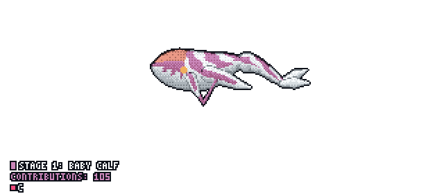

# Hi, I'm Shivam Kumar Barnwal 👋

### B.Tech CSE Student | DSA & Competitive Programming | Aspiring Open Source Contributor

I'm a Computer Science student who enjoys solving problems, learning how things work, and building my programming skills through consistent practice.

Currently, I'm focused on strengthening my Data Structures & Algorithms, improving problem-solving skills, exploring competitive programming, and gradually moving towards open-source contributions.

---

## 🚀 What I'm Currently Working On

- 📚 Practicing Data Structures & Algorithms using C++.
- 🧠 Improving problem-solving skills through LeetCode and competitive programming.
- 🏆 Exploring Codeforces and programming contests.
- 🔥 Maintaining consistency through daily coding practice.
- 🌱 Learning Git, GitHub, and collaborative development.
- 💻 Exploring real-world projects and open-source contributions.

## 🛠️ Tech Stack & Tools

**Languages**
- C++
- JavaScript
- HTML
- CSS

**Tools & Platforms**
- Git & GitHub
- VS Code
- Linux
- LeetCode
- Codeforces

## 📊 My Coding Journey

I believe consistency matters more than short-term motivation.

My current priorities are:
- Building strong programming fundamentals.
- Writing clean and understandable code.
- Developing logical thinking.
- Learning by building projects.
- Becoming confident enough to contribute to open-source projects.

## 🎯 2026–2027 Goals

- [ ] Strengthen DSA and problem-solving.
- [ ] Improve competitive programming skills.
- [ ] Build meaningful real-world projects.
- [ ] Make consistent GitHub contributions.
- [ ] Start contributing to open-source projects.
- [ ] Prepare for software development internships.

---

## 🐋 My GitHub Contribution Whale

  

---

## 📈 GitHub Statistics

  
  

---

### 💡 My Philosophy

> Consistency over intensity. Understand the logic, write the code, and keep improving.

**Thanks for visiting my profile!** 😊
